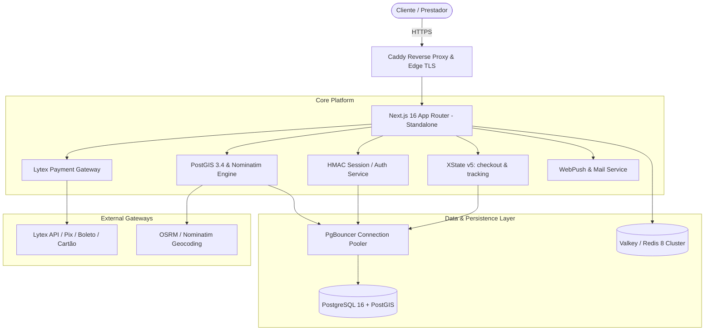
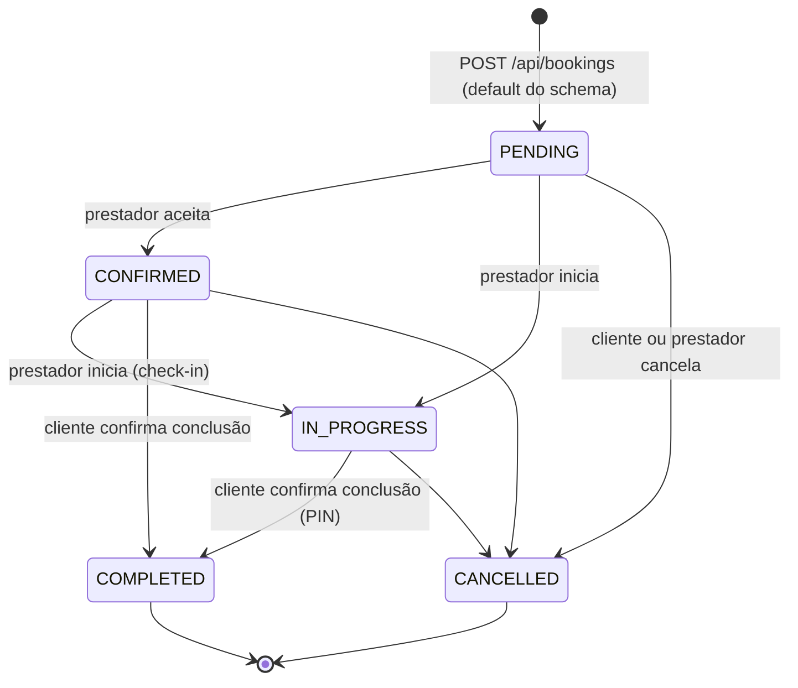

# Arquitetura Geral do Sistema — Severinno Marketplace SaaS

> Visão holística da arquitetura de software, fluxos de dados, componentes e infraestrutura do Severinno.

---

## 🗺️ 1. Diagrama de Arquitetura C4 (System Context)

---

## 🏛️ 2. Mapeamento das Camadas Técnicas

| Camada                   | Tecnologias Principais                         | Padrões Arquiteturais                                                                                                                                                 |
| ------------------------ | ---------------------------------------------- | --------------------------------------------------------------------------------------------------------------------------------------------------------------------- |
| **Apresentação & UI**    | React 19, Tailwind CSS, Radix UI, Lucide       | Design System Emerald, Code-Splitting (`next/dynamic`), WCAG 2.1 AA                                                                                                   |
| **Máquinas de Estado**   | XState v5, React Query, Zustand                | `checkout.machine.ts` e `tracking.machine.ts`; o ciclo do agendamento é o enum `BookingStatus`, com tabela de transições por papel na rota `PATCH /api/bookings/[id]` |
| **Borda & Segurança**    | Next.js Middleware, HMAC SHA-256               | HSTS Preload, Rate Limiting distribuído no Redis, CORS estrito, CSP                                                                                                   |
| **Negócio & Pagamentos** | Lytex SDK, Webhooks Idempotentes               | Split de pagamento com taxa de plataforma, Lock distribuído Redis (300s TTL)                                                                                          |
| **Geoespacial**          | PostGIS 3.4, ST_DWithin, GiST Index            | Cache multi-nível (L1 Memory, L2 Redis, L3 DB), fallback Haversine JS                                                                                                 |
| **Persistência**         | PostgreSQL 16, Prisma ORM, PgBouncer           | Native Enums PostgreSQL, Soft Delete Extension, Migrations versionadas                                                                                                |
| **Observabilidade**      | Pino Logger, GlitchTip / Sentry, OpenTelemetry | Rastreamento distribuído, DLQ Monitor, Health Check detalhado                                                                                                         |
| **CI/CD & Qualidade**    | GitHub Actions, Vitest, Playwright, Husky      | Testes de integração, pre-commit com barrel lint e validação UTF-8                                                                                                    |

---

## 🔄 3. Ciclo de Vida do Agendamento

O status vive no enum `BookingStatus` do schema (`PENDING`, `CONFIRMED`, `IN_PROGRESS`,
`COMPLETED`, `CANCELLED`). As transições são validadas por PAPEL na rota
`PATCH /api/bookings/[id]` (`PROVIDER_NEXT` / `CLIENT_NEXT`) — não há máquina XState
para booking; as máquinas do projeto são `src/machines/checkout.machine.ts` e
`src/machines/tracking.machine.ts`.

O pagamento corre em PARALELO no enum `PaymentStatus` (`PENDING`, `AUTHORIZED`,
`HELD`, `PAID`, `REFUNDED`, `FAILED`) e a liberação da custódia é carimbada em
`Booking.escrowReleasedAt` (`confirm-completion` / `checkin-escrow`), não em um
estado de payout separado.

---

## 📚 4. Índice de Guias Técnicos Detalhados

- 📖 [Manual Operacional de Produção](../docs/RUNBOOK.md)
- 💳 [Arquitetura de Pagamentos & Split](./payments-architecture.md)
- 🌍 [Arquitetura Geoespacial & PostGIS](./geolocation-architecture.md)
- ⚡ [Estratégia de Cache Multi-Nível](./CACHE_STRATEGY.md)
- 🛡️ [Manual de Segurança & Hardening](./SECURITY.md)
- 🧪 [Guia de Testes & Cobertura](./TESTING.md)
